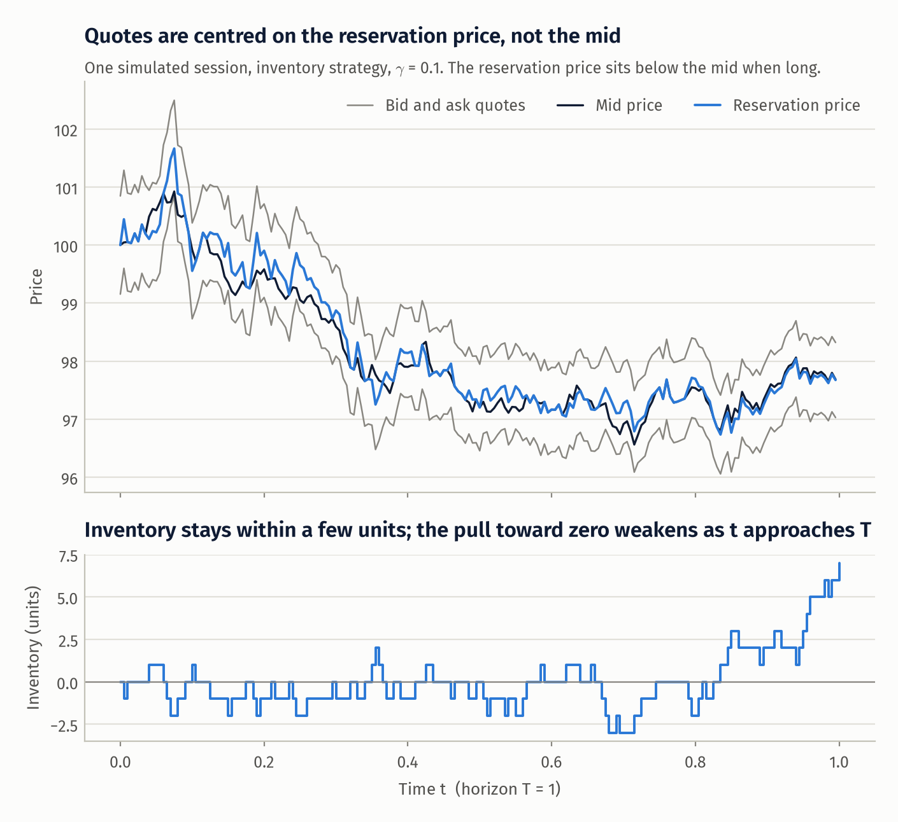
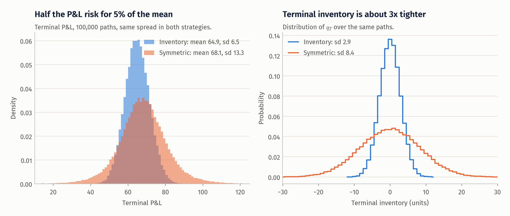
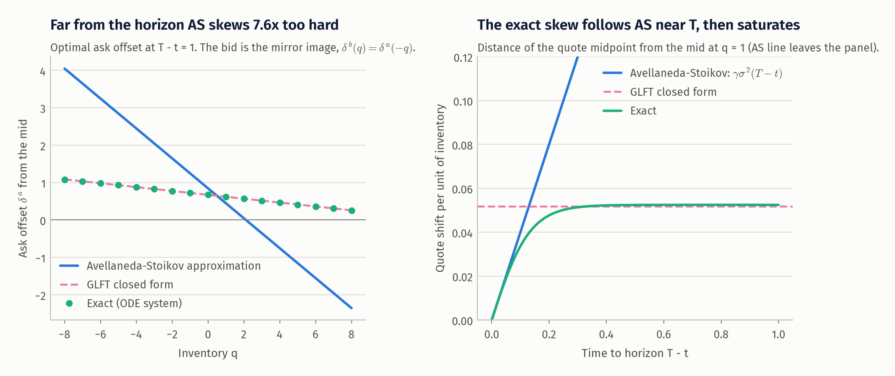
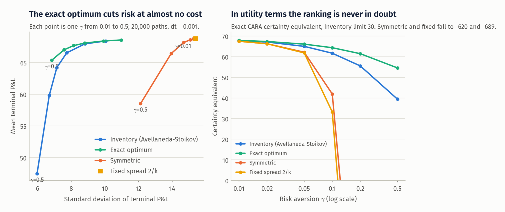
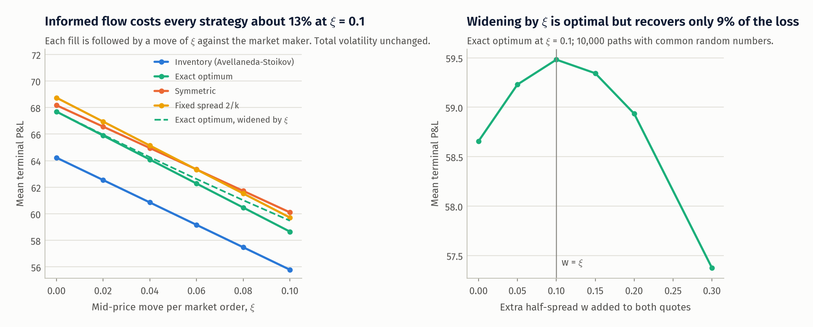
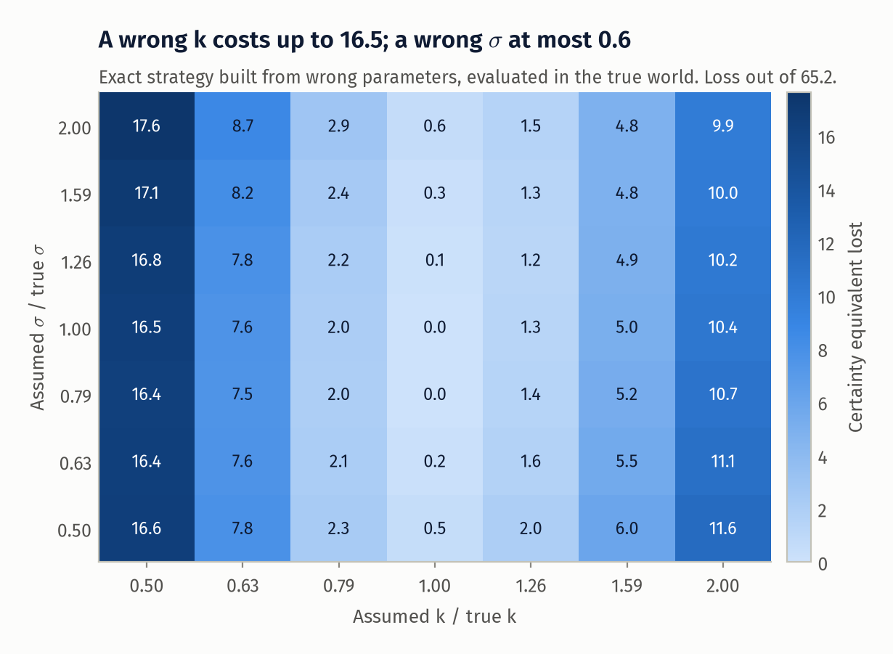

# Market making under inventory risk

I derive the Avellaneda-Stoikov market-making model, solve it exactly with inventory limits, simulate it, and then break its assumptions one at a time. On the paper's parameter set the inventory strategy gives up 4.6% of mean P&L against a symmetric quoter with the same spread (64.9 vs 68.1) and halves the P&L standard deviation (6.5 vs 13.3). The exact solution does better than the paper's approximation: it keeps the mean at 67.9 with a standard deviation of 7.3, because far from the horizon the approximation skews quotes 7.6 times harder than is optimal. Outside the model, order flow that moves the mid by 0.10 per trade removes 13% of P&L and the textbook fix recovers under a tenth of that, and getting the fill-decay parameter $k$ wrong by a factor of two costs 28 times more utility than getting volatility wrong by the same factor.

This is a simulation study. There is no market data. Parameters are illustrative (they are the ones in the original paper), and calibrating the fill intensity $\lambda(\delta)$ needs order-book and trade data that I do not have.

## The question

A market maker earns the spread and carries inventory she did not choose. Quote symmetrically around the mid and inventory wanders like a random walk, so P&L is dominated by price moves on whatever position she happens to hold. Skew the quotes against the position and inventory mean-reverts, at the cost of trading at worse prices. How much to skew, and how wide to quote, is a stochastic control problem. I want to know three things: what the optimal quotes are, how good the well-known closed-form approximation is, and how much of the answer survives when the world differs from the model.

## The mathematics

### Model

The mid price is $dS_t = \sigma\,dW_t$. The market maker posts a bid at $S_t-\delta^b_t$ and an ask at $S_t+\delta^a_t$. Fills on each side are Poisson with intensity

$$\lambda(\delta) = A e^{-k\delta},$$

each for one unit. Cash $X_t$ and inventory $q_t$ jump at fills: a bid fill gives $q \to q+1$, $X \to X-(S-\delta^b)$; an ask fill gives $q \to q-1$, $X \to X+(S+\delta^a)$. The objective is CARA utility of terminal wealth marked to mid,

$$u(t,s,x,q) = \max_{\delta^a,\delta^b}\ \mathbb{E}_t\left[-\exp\left(-\gamma\,(X_T+q_TS_T)\right)\right].$$

### HJB equation and the Avellaneda-Stoikov approximation

The value function satisfies

$$\partial_t u + \tfrac12\sigma^2\partial_{ss}u + \max_{\delta^b}\lambda(\delta^b)\left[u(t,s,x-s+\delta^b,q+1)-u\right] + \max_{\delta^a}\lambda(\delta^a)\left[u(t,s,x+s+\delta^a,q-1)-u\right] = 0,$$

with $u(T,s,x,q)=-e^{-\gamma(x+qs)}$. Substitute $u=-e^{-\gamma x}e^{-\gamma\theta(t,s,q)}$ and define the reservation bid and ask, the prices at which she is indifferent to one more unit,

$$r^b = \theta(t,s,q+1)-\theta(t,s,q),\qquad r^a = \theta(t,s,q)-\theta(t,s,q-1).$$

Dividing the HJB equation by $-\gamma u>0$ gives

$$\theta_t+\tfrac12\sigma^2\theta_{ss}-\tfrac12\sigma^2\gamma\,\theta_s^2+\max_{\delta^b}\frac{\lambda(\delta^b)}{\gamma}\left[1-e^{\gamma(s-\delta^b-r^b)}\right]+\max_{\delta^a}\frac{\lambda(\delta^a)}{\gamma}\left[1-e^{-\gamma(s+\delta^a-r^a)}\right]=0,\qquad \theta(T,s,q)=qs.$$

With $\lambda=Ae^{-k\delta}$ the first-order conditions are

$$\delta^b = s-r^b+\frac1\gamma\ln\left(1+\frac\gamma k\right),\qquad \delta^a = r^a-s+\frac1\gamma\ln\left(1+\frac\gamma k\right),$$

and each maximised term equals $A e^{-k\delta}/(k+\gamma)$. Avellaneda and Stoikov expand $\theta=\theta^0+q\theta^1+\tfrac12q^2\theta^2+\dots$ and linearise the fill term, $e^{-k\delta}\approx1-k\delta$, whose sum over the two sides does not depend on $q$ at this order. Matching powers of $q$:

$$\theta^1_t+\tfrac12\sigma^2\theta^1_{ss}=0,\ \theta^1(T)=s\ \Rightarrow\ \theta^1=s;\qquad \theta^2_t+\tfrac12\sigma^2\theta^2_{ss}-\sigma^2\gamma(\theta^1_s)^2=0,\ \theta^2(T)=0\ \Rightarrow\ \theta^2=-\gamma\sigma^2(T-t).$$

So $r^b=s-(2q+1)\gamma\sigma^2(T-t)/2$ and $r^a=s-(2q-1)\gamma\sigma^2(T-t)/2$, and

$$r=\frac{r^a+r^b}{2}=s-q\,\gamma\sigma^2(T-t),\qquad \delta^a+\delta^b=\gamma\sigma^2(T-t)+\frac2\gamma\ln\left(1+\frac\gamma k\right).$$

The quotes are the spread centred on the reservation price $r$. As $\gamma\to0$, $r\to s$ and the spread tends to $2/k$, which is the half-spread $1/k$ that maximises $\delta\,Ae^{-k\delta}$. Note what the approximation drops: the $q^2$ term carries no trading contribution, so the inventory penalty $\gamma\sigma^2(T-t)$ is the one for a position held untouched to the horizon.

### Exact solution with inventory limits

Following Guéant, Lehalle and Fernandez-Tapia (GLFT), restrict $q\in\{-Q,\dots,Q\}$ (no bid at $Q$, no ask at $-Q$) and substitute

$$u(t,s,x,q)=-e^{-\gamma(x+qs)}\,v_q(t)^{-\gamma/k}.$$

Writing $w_q=v_q^{-\gamma/k}$, the bid term of the HJB equation becomes $\inf_\delta Ae^{-k\delta}\left[e^{-\gamma\delta}w_{q+1}-w_q\right]$, minimised at $e^{-\gamma\delta}=k\,w_q/((k+\gamma)w_{q+1})$ with value $-\tfrac{\gamma}{k}\,\eta\,w_q\,v_{q+1}/v_q$. The nonlinear equation collapses to a linear system:

$$\dot v_q(t)=\alpha q^2v_q(t)-\eta\left(v_{q-1}(t)+v_{q+1}(t)\right),\qquad v_q(T)=1,$$

$$\alpha=\frac{k}{2}\gamma\sigma^2,\qquad \eta=A\left(1+\frac\gamma k\right)^{-(1+k/\gamma)},$$

with $v_{Q+1}=v_{-Q-1}=0$. In vector form $v(t)=e^{-M(T-t)}\mathbf 1$ where $M$ is tridiagonal with $\alpha q^2$ on the diagonal and $-\eta$ beside it. The optimal quotes are

$$\delta^b_q(t)=\frac1k\ln\frac{v_q(t)}{v_{q+1}(t)}+\frac1\gamma\ln\left(1+\frac\gamma k\right),\qquad \delta^a_q(t)=\frac1k\ln\frac{v_q(t)}{v_{q-1}(t)}+\frac1\gamma\ln\left(1+\frac\gamma k\right),$$

and the certainty equivalent of the optimal policy from zero inventory is $\tfrac1k\ln v_0(0)$.

Two limits tie this to the closed forms. Near the horizon, $\ln v_q\approx-(\alpha q^2-2\eta)(T-t)$, so $\delta^b_q\approx\tfrac1\gamma\ln(1+\gamma/k)+(2q+1)\gamma\sigma^2(T-t)/2$: exactly the Avellaneda-Stoikov quote. Far from the horizon $v(t)\propto e^{-\lambda_{\min}(T-t)}f$ where $f$ is the ground state of $M$, so the quotes stop depending on time. Replacing the discrete ground state by its continuous counterpart $f(q)\propto\exp(-\tfrac12\sqrt{\alpha/\eta}\,q^2)$ gives the GLFT closed form

$$\delta^b_\infty(q)\approx\frac1\gamma\ln\left(1+\frac\gamma k\right)+\frac{2q+1}{2}\sqrt{\frac{\sigma^2\gamma}{2kA}\left(1+\frac\gamma k\right)^{1+k/\gamma}},\qquad \delta^a_\infty(q)=\delta^b_\infty(-q).$$

### Exact utility of any quoting rule

A Monte Carlo estimate of $\mathbb E[e^{-\gamma W}]$ is dominated by the worst few paths once $\gamma\cdot\mathrm{sd}(W)$ exceeds about 2, so I do not trust sampled certainty equivalents for the risky strategies. For any rule $\delta^{a,b}_q(t)$ the expected utility keeps the form $-e^{-\gamma(x+qs)}w_q$, and for the discretised chain the simulator runs, $w$ satisfies an exact backward recursion because $\mathbb E\,e^{-\gamma q\,\Delta S}=e^{\gamma^2\sigma^2q^2\Delta t/2}$:

$$w_q\leftarrow\sum_{f_b,f_a\in\{0,1\}}P(f_b)P(f_a)\,e^{-\gamma(\delta^bf_b+\delta^af_a)}\,e^{\gamma^2\sigma^2q'^2\Delta t/2}\,w_{q'},\qquad q'=q+f_b-f_a.$$

The certainty equivalent is $-\tfrac1\gamma\ln w_0$. This is what I report as the exact certainty equivalent. One consequence is worth stating: without an inventory limit the CARA utility of a symmetric strategy is $-\infty$, because the weight $e^{\gamma^2\sigma^2q^2(T-t)/2}$ grows faster than the Poisson tail of $q$ decays. The limit $Q$ is what makes the comparison well posed, which is also why GLFT impose it.

## Method

- **Parameters**, fixed before any run and taken from the paper: $s_0=100$, $T=1$, $\sigma=2$, $A=140$, $k=1.5$, $q_0=0$, $\gamma\in\{0.01,0.1,0.5\}$ with $\gamma=0.1$ as baseline. Inventory limit $Q=30$ for the exact solution and for every utility comparison. Seed 2008 throughout.
- **Simulator** (`src/mmsim/simulate.py`), vectorised over paths. Each step: compute quotes from $(T-t,q)$; fill the bid with probability $\min(1,Ae^{-k\delta^b}\Delta t)$ and the ask likewise, independently, at most one fill per side; then move the mid by $\sigma\sqrt{\Delta t}\,N(0,1)$. The Bernoulli fill approximates the Poisson arrival and needs $Ae^{-k\delta}\Delta t\ll1$.
- **Strategies**: *inventory* (Avellaneda-Stoikov spread centred on $r$); *symmetric* (the same spread centred on the mid, the paper's benchmark); *exact* (the ODE optimum with limit $Q$); *fixed* (constant half-spread $1/k$).
- **Replication** uses the paper's $\Delta t=0.005$ with 100,000 paths. At typical quotes $\lambda\Delta t\approx0.25$, which is not small, so I rerun at $\Delta t=0.0005$ as a check. The other experiments use $\Delta t=0.001$ and 10,000 to 20,000 paths, with common random numbers across strategies.
- **Numerics of the ODE system**: $v$ and $w$ are positive but span hundreds of orders of magnitude across $q$, and a general matrix exponential loses the small components. I compute $e^{hB}v$ as a Taylor series of non-negative terms in log space. It agrees with `scipy.linalg.expm` to $10^{-9}$ where that is accurate.
- **Verification** (17 tests): the fill rate matches $Ae^{-k\delta}$; the wealth identity holds step by step; $\gamma\to0$ limits; the ODE residual and terminal condition; exact quotes converge to the stationary solution (to $10^{-8}$) and to the GLFT closed form; exact quotes match Avellaneda-Stoikov near the horizon with an error that shrinks faster than $(T-t)^2$; simulated certainty equivalents match the exact recursion within Monte Carlo error; seeded runs reproduce; switching the extensions off reproduces the baseline paths bit for bit.

## Results

### One path



The quotes follow the reservation price, which sits below the mid when inventory is positive and above it when negative. The skew is proportional to $T-t$, so it fades to nothing at the horizon.

### Replication of the paper's simulation

$\gamma=0.1$, $\Delta t=0.005$, 100,000 paths. Standard error of every mean P&L is below 0.05.

| Strategy | Mean spread | Mean P&L | SD P&L | SD terminal inventory | Exact CE ($Q=30$) |
|---|---|---|---|---|---|
| Inventory (AS) | 1.49 | 64.92 | 6.55 | 2.94 | 62.79 |
| Symmetric | 1.49 | 68.06 | 13.34 | 8.42 | 50.08 |
| Exact optimum | 1.34 | 67.86 | 7.28 | 3.10 | 65.24 |
| Fixed $2/k$ | 1.33 | 68.70 | 13.78 | 8.75 | 45.38 |



This is the paper's qualitative result: for the same spread, the inventory strategy earns slightly less on average (4.6% less), with a P&L standard deviation 2.04 times smaller and a terminal inventory standard deviation 2.87 times smaller. I do not quote the paper's own table; the comparison is qualitative. The same holds at the other two risk aversions: at $\gamma=0.01$ the inventory strategy has mean 68.43 and SD 9.01 against 68.70 and 13.74 for symmetric; at $\gamma=0.5$ it has 48.57 and 5.90 against 58.40 and 11.56.

The paper's time step is coarse. At $\Delta t=0.0005$ the inventory strategy has mean 64.09 and SD 7.22, and the symmetric one 68.18 and 14.96. Means move by about 1%; standard deviations are about 10% higher, because allowing one fill per side per step understates fill dispersion. The qualitative comparison is unchanged.

### Exact quotes against the two closed forms



Near the horizon the approximation is accurate: at $T-t=0.05$ the largest difference between exact and Avellaneda-Stoikov bid offsets over $|q|\le5$ is 0.005. At $T-t=1$ it is 1.91. The Avellaneda-Stoikov skew per unit of inventory is $\gamma\sigma^2(T-t)=0.40$; the exact one is 0.052, a factor of 7.6 smaller, and it is within 5% of its limit from $T-t=0.245$ outwards. The GLFT closed form gives 0.052 and matches the exact quotes to 0.007 over $|q|\le10$. The reason is the term the approximation drops: it penalises inventory as if it were carried to $T$, while a market maker with 140 orders per unit time at the touch can trade out of a position quickly. With these parameters the stationary regime, not the near-horizon one, describes most of the session.

This shows up in the table above. The exact strategy quotes a tighter spread (1.34 vs 1.49), keeps almost all of the symmetric strategy's mean (67.86 vs 68.06) and almost all of the inventory strategy's risk reduction (SD 7.28 vs 6.55). At $\gamma=0.5$ the gap is large: mean 66.07 against 48.57, with similar SD (6.14 vs 5.90).

### Risk-aversion frontier



$\Delta t=0.001$, 20,000 paths, inventory limit 30 for all strategies. In mean-SD space the exact optimum sits up and to the left of the approximation at every $\gamma$. In utility terms theory says the exact strategy must dominate, and it does at every $\gamma$ tested. At $\gamma=0.1$ the exact certainty equivalents are 64.35 (exact), 61.68 (inventory), 41.93 (symmetric) and 33.21 (fixed), so the approximation costs 2.7 units of certainty equivalent. The continuous-time optimum $\tfrac1k\ln v_0(0)$ is 64.13; the simulated chain is slightly above it because Bernoulli fills are less dispersed than Poisson ones, and the gap shrinks linearly in $\Delta t$.

The sampled certainty equivalents show why the exact recursion matters. For the two inventory-aware strategies they agree with the exact values within about one standard error (61.72 ± 0.06 and 64.43 ± 0.07). For the symmetric strategy the sample gives 53.69 against an exact 41.93: the estimate misses the rare paths that carry the expected utility. At $\gamma=0.5$ the exact values for symmetric and fixed are -620 and -689, set almost entirely by the inventory limit.

### Adverse selection

I change the world, not the model the strategies believe in. Market orders arrive on each side at rate $A$; each moves the mid by $\xi$ in its own direction, and those that reach my quote also fill me. A fill at my ask is therefore followed by a move of $+\xi$. The diffusion variance is reduced so that the total variance of the mid stays $\sigma^2$; this caps $\xi$ at $\sigma/\sqrt{2A}=0.12$, the point where order flow explains all of the volatility.



At $\xi=0.10$ mean P&L falls by 13.1% (inventory, 64.22 to 55.79), 13.3% (exact, 67.69 to 58.66), 11.8% (symmetric) and 13.1% (fixed). The loss is first order and close to mechanical: $\xi(1-A\Delta t)$ per fill predicts 8.44, 8.97, 7.91 and 8.86 against realised 8.43, 9.03, 8.06 and 9.02. No strategy is protected, because inventory control does not address who is on the other side of the trade.

The simple fix is to widen both quotes by $\xi$. In the HJB equation with this price impact the fill term depends on $\delta$ only through $\delta-\xi$, so the shift is the correct structural change, and a sweep over the extra half-spread $w$ for the exact strategy peaks at $w=\xi$ (58.66, 59.23, 59.48, 59.34, 58.93, 57.38 for $w=0,0.05,0.10,0.15,0.20,0.30$). It recovers little: 0.82 of 9.03 lost for the exact strategy (9%), 0.65 for the inventory strategy (8%), and it lowers the symmetric strategy's mean by 0.50 because that strategy's spread is already wider than the myopic optimum early in the session. The explanation is the envelope theorem. Expected profit per unit time is $(\delta-\xi)Ae^{-k\delta}$; the loss from $\xi$ is first order in $k\xi$, while re-optimising $\delta$ gains only $(k\xi)^2/2$, about 1% here. Widening restores the edge per fill and pays for it in fill rate.

### Misspecification

The market maker builds the exact strategy from $\hat\sigma=m_\sigma\sigma$ and $\hat k=m_kk$; the world runs on the true values. The loss is computed with the exact recursion at $\Delta t=0.005$, so there is no sampling noise.



The correctly specified certainty equivalent is 65.24. Volatility wrong by a factor of two in either direction costs at most 0.59. $k$ wrong by the same factor costs 16.54 (assumed $k$ half the truth: quotes twice as wide as they should be) or 10.44 (assumed $k$ double: quotes too tight). The ratio of the two worst cases is 28. The worst cell of the grid ($\hat\sigma=2\sigma$, $\hat k=k/2$) loses 17.60, or 27%; a 100,000-path simulation of that cell gives 47.64 ± 0.03 against the exact 47.63. The reason is that $k$ sets the base half-spread $\tfrac1\gamma\ln(1+\gamma/k)\approx1/k$, a first-order effect on every trade, while $\sigma$ enters only the inventory skew. The parameter that matters most is the one this project cannot calibrate.

## What this does not show

- **Nothing here is calibrated.** $A$ and $k$ are the paper's illustrative values. With them the spread is wide relative to volatility and a session earns about ten times its P&L standard deviation, which no real market offers. The numbers show mechanisms, not attainable returns.
- **The fill model is the weakest assumption.** Exponential intensity in distance from the mid, independent of queue position, tick size, order size, time of day and the state of the book. The misspecification result says this is where errors are expensive.
- **The Avellaneda-Stoikov quotes cross the mid** when $|q|\gamma\sigma^2(T-t)$ exceeds the half-spread, and the model then assigns them intensities above $A$. I simulate the formula as written, as the paper does. A production version would floor the offsets.
- **Certainty equivalents of the symmetric and fixed strategies depend on the inventory limit** at high $\gamma$. They are finite only because $Q$ is. The ranking is robust; the magnitudes are not.
- **The paper's $\Delta t$ is coarse** and understates P&L dispersion by roughly 10%. I keep it for the replication and say so.
- **The adverse-selection world is reduced form.** Every market order has the same impact, impact is permanent, and holding total variance fixed caps toxicity at a level where it removes about an eighth of P&L. In real markets adverse selection takes a much larger share of the quoted spread.
- **Fat tails are not tested.** The simulator can add compound-Poisson jumps to the mid with total variance held fixed, and a test covers that, but I have not run the experiment or analysed tail risk.
- **No costs, fees, rebates, latency, discrete ticks or multi-unit orders**, and the horizon is a fixed $T$ at which inventory is marked to mid with no liquidation cost.

## What I would do next

1. Calibrate $\lambda(\delta)$ from order-book and trade data, per queue position, and repeat the misspecification experiment with estimation error in place of arbitrary multipliers.
2. Solve the linear system for the price-impact world directly (it stays linear in $v$) and measure how much of the adverse-selection loss the fully re-optimised strategy recovers beyond the shift by $\xi$.
3. Run the jump experiment: terminal P&L tails and expected shortfall with part of the variance in jumps, and a terminal liquidation penalty in place of marking to mid.
4. Replace the fixed horizon with the stationary (ergodic) formulation, which the quote comparison suggests is the relevant regime anyway.

## Reproduce

```bash
python -m venv .venv && .venv/Scripts/activate      # or source .venv/bin/activate
pip install -r requirements.txt
pip install -e .
python -m pytest                                    # 17 tests, about 6 seconds
python scripts/01_run_experiments.py                # about 1 minute; writes results/
python scripts/02_make_figures.py                   # writes figures/
```

Every number above is in `results/summary.json`. `results/web/strategy_table.json` holds the replication table for $\gamma\in\{0.01,0.1,0.5\}$ with the exact discretisation spelled out, and `results/web/quotes_by_inventory.json` holds exact, Avellaneda-Stoikov and GLFT quotes for $q=-30,\dots,30$ at four times to horizon.

## References

- Avellaneda, M. and Stoikov, S. (2008). High-frequency trading in a limit order book. *Quantitative Finance*, 8(3), 217-224.
- Guéant, O., Lehalle, C.-A. and Fernandez-Tapia, J. (2013). Dealing with the inventory risk: a solution to the market making problem. *Mathematics and Financial Economics*, 7(4), 477-507.
- Ho, T. and Stoll, H. R. (1981). Optimal dealer pricing under transactions and return uncertainty. *Journal of Financial Economics*, 9(1), 47-73.
- Glosten, L. R. and Milgrom, P. R. (1985). Bid, ask and transaction prices in a specialist market with heterogeneously informed traders. *Journal of Financial Economics*, 14(1), 71-100.
- Cartea, Á., Jaimungal, S. and Penalva, J. (2015). *Algorithmic and High-Frequency Trading*. Cambridge University Press.
